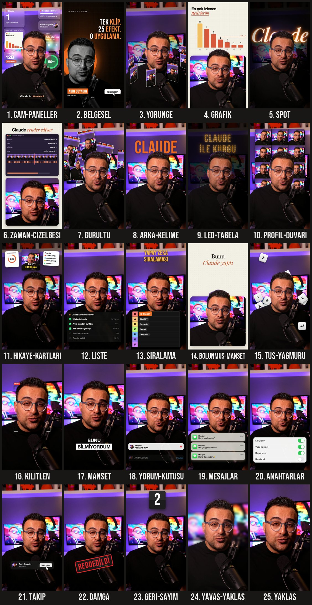

# Claude için 25 Video Efekti

Videonu Claude'a sürükle, `/efekt` yaz ve efektin adını söyle. Kurgu bu kadar.

[@ugur.saricam](https://instagram.com/ugur.saricam) hazırladı 🧡



## Kurulum (tek satır)

Terminal uygulamasını aç (ya da Claude Code'un içindeki terminali) ve yapıştır:

```bash
git clone https://github.com/ugursaricam/claude-kurgu-efektleri ~/.claude/skills/efekt
```

Sonra Claude Code'u yeniden başlat. Hepsi bu.

> Nasıl yapacağını bilmiyor musun? Claude Code'u aç ve şunu yapıştır: **"github.com/ugursaricam/claude-kurgu-efektleri skill'ini ~/.claude/skills/efekt içine kur"**. Claude senin yerine yapar.

## Kullanım

1. Claude Code'u aç (uygulama ya da terminal).
2. Videonu sohbete sürükle.
3. İstediğin efekti yaz:

```
/efekt yorunge 3. saniyeden 6'ya kadar
/efekt spot "ışıkları kapat" dediğimde, arkamda Claude yazsın
/efekt yorum-kutusu sonda, ANİMASYON yazsın
/efekt cam-paneller ilk 3 saniye
```

İlk seferde Claude kendini kurar (yaklaşık 2 dakika). `ffmpeg`, Node ve Python gerekir; eksikse Claude onları da kurar.

Claude önce birkaç kareye bakar ve yüzünü kapatan bir şey varsa düzeltir. Sonra orijinal videonun yanına `videon_efekt.mp4` dosyasını çıkarır. Sesin olduğu gibi kalır.

Birden fazla efekti tek seferde isteyebilirsin: *"6-10 arası kilitlen, 10-13 arası yörünge, 'hayır' dediğimde damga."*

## 25 efekt

| # | Bunu yaz | Ne oluyor |
|---|---|---|
| 1 | `cam-paneller` | Buzlu cam paneller başının arkasında süzülür, altta "Claude ile düzenlendi" yazar |
| 2 | `belgesel` | Siyah-beyaz sen, başının arkasında turuncu daire, satır satır başlık, isim bandı ve Takip et → Takiptesin |
| 3 | `yorunge` | Reels'lerin başının etrafında döner: tepeden geçerken arkanda, önden geçerken önünde |
| 4 | `grafik` | Üstte gerçek izlenme grafiği, altta pencerede sen; başın pencereden taşar |
| 5 | `spot` | Işıklar söner, sen aydınlıkta kalırsın, arkanda neon bir yazı yanar |
| 6 | `zaman-cizelgesi` | Üstte kurgu programı ve ilerleyen oynatma çizgisi, altta sen |
| 7 | `gurultu` | Reels'ler başının arkasına üst üste yığılır |
| 8 | `arka-kelime` | Dev bir kelime arkana düşer |
| 9 | `led-tabela` | Işıklar düşer, arkanda parlayan bir LED tabela kendini yazar |
| 10 | `profil-duvari` | Reels ızgaran arkandaki duvarı doldurur, sayaç artar |
| 11 | `hikaye-kartlari` | Süre, görsel ve yorum kartları yukarıdan düşer, başlık başının üstünde durur |
| 12 | `liste` | Claude'un görev listesi: adımlar tek tek yeşil tik alır |
| 13 | `siralama` | Tier list düşer, Claude S'ye uçar |
| 14 | `bolunmus-manset` | Manşet kartı yukarıdan iner, seni alt yarıya iter; başın pencereden taşar |
| 15 | `tus-yagmuru` | Klavye tuşları arkana yağar |
| 16 | `kilitlen` | Köşe parantezleri yüzüne kilitlenir, kamera seni takip eder |
| 17 | `manset` | Yakınlaşma ve iki satırlık manşet; ikinci satır beyaz kutuda |
| 18 | `yorum-kutusu` | Instagram yorum kutusuna bir kelime yazılır ve paylaşılır |
| 19 | `mesajlar` | Mesaj bildirimleri birbiri ardına düşer |
| 20 | `anahtarlar` | iPhone ayar kartındaki anahtarlar tek tek açılır |
| 21 | `takip` | Takip et butonu çıkar ve Takiptesin'e döner |
| 22 | `damga` | Kocaman kırmızı bir damga ekrana iner |
| 23 | `geri-sayim` | Başının üstünde 3, 2, 1 çevirmeli saat |
| 24 | `yavas-yaklas` | Yavaş sinematik yaklaşma: oda bulanıklaşır, sen net kalırsın |
| 25 | `yaklas` | Tek kelimede hızlı yakınlaşma |

İngilizce adlar da çalışır (`orbit`, `spotlight`, `glass-widgets`, `locked-on`, `comment-box`, `tier-list`…).

Bonus: Claude uygulaması arayüzünde `/komut` yazılıp sonucun tam ekrana açıldığı iki hazır Reels şablonu var: `/efekt şablon 7-efekt` ve `/efekt şablon 6-stil`.

Bütün efektler yüzünü takip eder. Yüzünü kapatacak her şey başının arkasına geçer.

**İpuçları**
- En iyi sonucu, kadrajda olduğun dikey telefon videoları verir.
- Zamanlamayı düz cümleyle söyle ("'izle' dediğimde"). Claude tam saniyeyi bulur.
- `yorunge`, `gurultu`, `profil-duvari` ve `zaman-cizelgesi` için kendi Reels'lerini kullanmak mı istiyorsun? Claude'a ekran görüntülerinin olduğu klasörü ver.
- Grafiklerde, sayaçlarda ve manşetlerde gerçek sayılarını kullan. Claude'a ne olduklarını söyle.
- Kişi ayırma varsayılan olarak kaliteli moddadır: saç telleri net çıkar ama render biraz sürer. Acelen varsa "hızlı maske" de; saç kenarları kabalaşır.

## Açık konuşalım
- Bunlar **başlangıç sürümleri**. Benim Reels'imdeki kurguyla birebir aynı değiller; o kurguda ses tasarımı ve elle ayarlanmış zamanlama da var.
- Claude taslak çıkarır, sen onaylarsın. Paylaşmadan önce sonucu izle.
- Rengin olduğu gibi kalır: keskinlik, filtre ya da renk ayarı yapılmaz.

## Bir şey ters giderse
Claude'a ne gördüğünü söyle ("yazı yüzümü kapatıyor", "çok hızlı"). Planı düzeltir ve yeniden render alır.

## Teşekkürler
- Fikir, efekt listesinin mantığı ve bu README'nin yapısı: [Vibha Ramprakash / claude-video-effects](https://github.com/Vibha-Ramprakash/claude-video-effects) (MIT).
- Yüz takibi: [OpenCV YuNet](https://github.com/opencv/opencv_zoo) (MIT).
- Kişi ayırma: [U2Net](https://github.com/xuebinqin/U-2-Net) (Apache 2.0) ve [BiRefNet](https://github.com/ZhengPeng7/BiRefNet) (MIT), [rembg](https://github.com/danielgatis/rembg) üzerinden.
- Animasyon: [HyperFrames](https://www.npmjs.com/package/hyperframes) + GSAP.
- Fontlar: Bebas Neue ve Playfair Display (SIL OFL). Lisanslar `sablonlar/fontlar/` içinde.
- Geri kalan her şey MIT, bkz. `LICENSE`.
